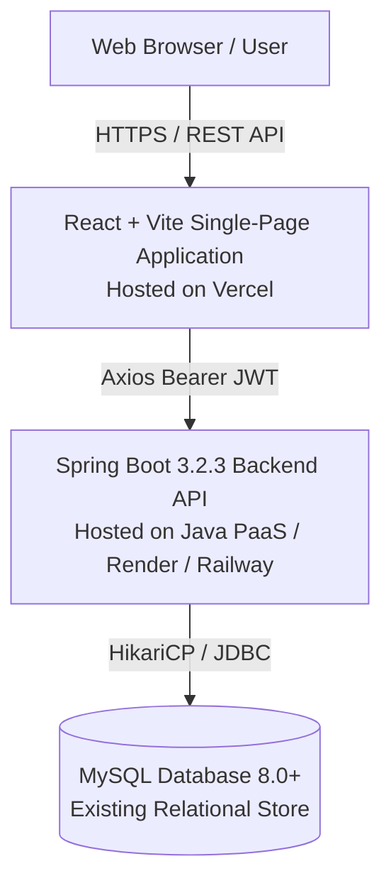

# MediStock System Architecture

## 1. System Overview

**MediStock** is an enterprise-grade medical inventory management platform designed to automate pharmacy procurement, monitor real-time stock levels, prevent batch expiry waste, and facilitate external supplier order fulfillment.

---

## 2. Technology Stack & Runtime Topology

| Layer | Technology | Responsibilities |
|---|---|---|
| **Frontend UI** | React 18, Vite, React Router 6, Tailwind CSS, Lucide Icons | Client-side routing, role-based navigation, state management, authenticated Axios interceptors |
| **Backend API** | Java 21/25, Spring Boot 3.2, Spring Security, Spring Data JPA, Hibernate 6, Maven | RESTful endpoints, JWT generation & validation, BCrypt hashing, transaction management, role authorization |
| **Persistence** | MySQL 8.0, HikariCP Connection Pool | Relational data integrity, foreign key constraints, indexes, audit logging |
| **Security** | JWT (HMAC-SHA256), Spring Security Filter Chain | Stateless token authentication, endpoint-level `@PreAuthorize` authorization |

---

## 3. Four User Roles & Authorization Matrix

MediStock enforces server-side role boundaries. Frontend navigation and route guards provide UI routing convenience, but all operations are strictly verified by Spring Security.

| Operation / Area | ADMIN | PHARMACIST | STAFF | SUPPLIER |
|---|:---:|:---:|:---:|:---:|
| System Health (`/api/health`) | Public | Public | Public | Public |
| Login / Register (`/api/auth/*`) | Public | Public | Public | Public |
| Dashboard Analytics (`/api/analytics/*`) | ✅ | ✅ | ✅ | ❌ (403) |
| View Medicine Catalog (`/api/medicines`) | ✅ | ✅ | ✅ | ❌ (403) |
| Create / Update Medicines | ✅ | ✅ | ❌ (403) | ❌ (403) |
| Expiry Tracking (`/api/expiry/*`) | ✅ | ✅ | ❌ (403) | ❌ (403) |
| View Suppliers Directory (`/api/suppliers`) | ✅ | ✅ | ❌ (403) | ❌ (403) |
| View Purchase Orders (`/api/orders`) | ✅ | ✅ | ❌ (403) | ❌ (403) |
| Manage Users & Roles (`/api/users`) | ✅ | ❌ (403) | ❌ (403) | ❌ (403) |
| Supplier Portal (`/api/suppliers/me`) | ❌ (403) | ❌ (403) | ❌ (403) | ✅ (Isolated) |
| View Supplier Orders (`/api/suppliers/me/orders`)| ❌ (403) | ❌ (403) | ❌ (403) | ✅ (Isolated) |

---

## 4. Supplier Account Isolation Model

External supplier partners have access restricted exclusively to their assigned orders and organization record:
1. **Database Linkage**: The `users` table contains a nullable `supplier_id` foreign key referencing `suppliers(id)`.
2. **Account Creation Rule**: When a `SUPPLIER` account is provisioned (via Admin API or public registration), a valid `supplierId` is mandatory. Public registration rejects any attempt to register without a valid `supplierId` or with an elevated `ADMIN` role.
3. **Backend Service Layer Guard**: Endpoints `/api/suppliers/me` and `/api/suppliers/me/orders` inspect the Spring Security `Authentication.getName()` context, query the user's `supplier_id`, and resolve only that specific supplier's records. A supplier cannot supply an ID parameter to read or alter another supplier's data.
4. **Isolated Frontend Experience**: The React sidebar detects the `SUPPLIER` role and renders an isolated workspace menu, suppressing internal operational links.

---

## 5. Security & Authentication Architecture

1. **Stateless JWT Tokens**:
   - Signature algorithm: `HMAC-SHA256`.
   - Secret key: Minimum 256-bit configurable key passed via `JWT_SECRET`.
   - Expiration: Configurable (defaults to 24 hours).
2. **Password Security**:
   - Passwords hashed using `BCryptPasswordEncoder` (work factor 10). Plain-text passwords are never persisted or returned in API responses.
3. **CORS Policy**:
   - Allowed origins configured dynamically via `CORS_ALLOWED_ORIGINS` (supports comma-separated development `http://localhost:5173` and deployed Vercel domains).
