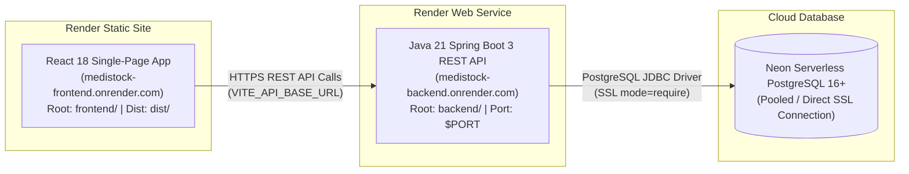

# MediStock Deployment Guide: Render & Neon PostgreSQL Migration

This guide details the complete deployment process for running the **MediStock** medical inventory management platform on **Render** (both React Frontend and Spring Boot Backend) connected to **Neon PostgreSQL**.

---

## 1. Full-Stack Deployment Architecture



---

## 2. Database Setup: Neon PostgreSQL

### Step 1: Provision a Neon PostgreSQL Database
1. Sign in to [Neon Console](https://console.neon.tech).
2. Create a new project (e.g., `medistock-db`).
3. Note your connection string from the Neon dashboard:
   - Format: `postgresql://<user>:<password>@<neon-host>/<database>?sslmode=require`
   - Spring Boot JDBC format: `jdbc:postgresql://<neon-host>:5432/<database>?sslmode=require`

### Step 2: Apply Database Schema & Seed Data
Execute the provided PostgreSQL migration scripts using `psql`:

```bash
# Apply schema tables, relationships, and indexes
psql "postgresql://<user>:<password>@<neon-host>/<database>?sslmode=require" -f database/postgres_schema.sql

# Apply default system roles, suppliers, categories, and test users
psql "postgresql://<user>:<password>@<neon-host>/<database>?sslmode=require" -f database/postgres_seed.sql
```

> **Safety Notice:** Do NOT use `ddl-auto: create` or `ddl-auto: create-drop` in production. MediStock uses `ddl-auto: validate` with safe SQL migration scripts.

---

## 3. Backend Deployment: Render Web Service

### Option A: Via Render Blueprint (`render.yaml`)
If deploying with Blueprints, simply select `New > Blueprint` in the Render dashboard and link your `medistock` repository. Render will automatically parse [`render.yaml`](file:///Users/malthumkarvarun/infosys/render.yaml).

### Option B: Manual Web Service Setup
1. Log in to [Render Dashboard](https://dashboard.render.com).
2. Click **New + > Web Service** and select your GitHub repository `varun05126/medistock`.
3. Configure the following service settings:
   - **Name**: `medistock-backend`
   - **Region**: Select region closest to your Neon database (e.g., Oregon, Frankfurt)
   - **Branch**: `main`
   - **Root Directory**: `backend`
   - **Runtime**: `Java` (Java 21)
   - **Build Command**: `chmod +x mvnw && ./mvnw clean package -DskipTests`
   - **Start Command**: `java -jar target/medistock-backend-1.0.0-SNAPSHOT.jar`
   - **Health Check Path**: `/api/health`
   - **Plan**: Free or Starter

4. Configure Backend Environment Variables in Render:
   | Key | Value / Example | Description |
   |---|---|---|
   | `SPRING_PROFILES_ACTIVE` | `prod` | Activates production configuration |
   | `SPRING_DATASOURCE_URL` | `jdbc:postgresql://<neon-host>:5432/<database>?sslmode=require` | Neon PostgreSQL JDBC connection string |
   | `SPRING_DATASOURCE_USERNAME` | `<neon-user>` | Neon database username |
   | `SPRING_DATASOURCE_PASSWORD` | `<neon-password>` | Neon database password |
   | `SPRING_DATASOURCE_DRIVER` | `org.postgresql.Driver` | PostgreSQL JDBC driver class |
   | `SPRING_JPA_HIBERNATE_DDL_AUTO` | `validate` | Safe schema verification |
   | `JWT_SECRET` | `secure256BitOrHigherSecretKeyGeneratedForHMACSHA256SignaturesMediStock2026!` | JWT signing secret |
   | `CORS_ALLOWED_ORIGINS` | `https://medistock-frontend.onrender.com,https://*.onrender.com,http://localhost:5173` | Allowed frontend origins |

---

## 4. Frontend Deployment: Render Static Site

### Step 1: Create Render Static Site
1. In the Render Dashboard, click **New + > Static Site**.
2. Select the same repository `varun05126/medistock`.
3. Configure settings:
   - **Name**: `medistock-frontend`
   - **Branch**: `main`
   - **Root Directory**: `frontend`
   - **Build Command**: `npm install && npm run build`
   - **Publish Directory**: `dist`

### Step 2: Configure Client-Side Routing (SPA Rewrites)
Render Static Sites require rewrite rules so that direct navigation to routes like `/login`, `/dashboard`, and `/supplier/portal` do not return 404 errors on refresh.

This is automatically handled via:
1. The [`frontend/public/_redirects`](file:///Users/malthumkarvarun/infosys/frontend/public/_redirects) file containing:
   ```text
   /*    /index.html   200
   ```
2. The `routes` rewrite block in [`render.yaml`](file:///Users/malthumkarvarun/infosys/render.yaml).

### Step 3: Configure Frontend Environment Variables
In the Render Static Site dashboard (**Environment** tab), set:
| Key | Value | Description |
|---|---|---|
| `VITE_API_BASE_URL` | `https://medistock-backend.onrender.com/api` | The HTTPS URL of your deployed Render backend |

> **Note on Vite Build-Time Variables:** In Vite apps, `VITE_API_BASE_URL` is statically bundled into JavaScript during `npm run build`. Whenever you change this variable, you must trigger a **Manual Deploy > Clear build cache & deploy**.

---

## 5. End-to-End Migration Verification Checklist

Before decommissioning the legacy Vercel deployment, verify every check:

| # | Check Item | Verification Command / Step | Status |
|---|---|---|---|
| 1 | Backend builds with Java 21 | `./mvnw clean package -DskipTests` | ✅ Verified |
| 2 | Backend passes all unit tests | `./mvnw test` (13 tests pass) | ✅ Verified |
| 3 | Frontend builds with Vite | `npm run build` | ✅ Verified |
| 4 | Frontend passes all unit tests | `npm test` (9 tests pass) | ✅ Verified |
| 5 | SPA Rewrite rule present | `dist/_redirects` exists | ✅ Verified |
| 6 | Render Backend health check | `curl https://<backend>.onrender.com/api/health` returns `{"status":"UP","database":"CONNECTED"}` | Pending live provisioning |
| 7 | Authentication API operational | `POST /api/auth/login` validates credentials and role | ✅ Tested locally |
| 8 | Role-based navigation works | Admin, Pharmacist, Staff, Supplier dashboards | ✅ Tested locally |
| 9 | Direct URL refresh works | Refreshing `/login` loads SPA | ✅ Configured |
| 10 | No secrets in frontend bundle | Audited client bundle for DB/JWT secrets | ✅ Clean |

---

## 6. Decommissioning the Legacy Vercel Deployment

Once the Render frontend and backend are fully operational and verified:

1. **Test live traffic on Render**: Ensure users can sign in via `https://medistock-frontend.onrender.com`.
2. **Log in to Vercel**: Navigate to [https://vercel.com/dashboard](https://vercel.com/dashboard).
3. **Select Project**: Open the `frontend` project.
4. **Delete or Disable Project**:
   - Go to **Settings > General**.
   - Scroll to the bottom to the **Delete Project** section.
   - Click **Delete**, type the project name to confirm, and submit.
   - Alternatively, pause the project domain in **Settings > Domains** to prevent traffic before full deletion.
